# Cart and checkout evidence

Before images are the five originals supplied with the request. After images were captured in Chrome at 1280 × 900. The header-only original is paired with a full-page viewport capture.

## Quantity 2: $219.58 subtotal

Before

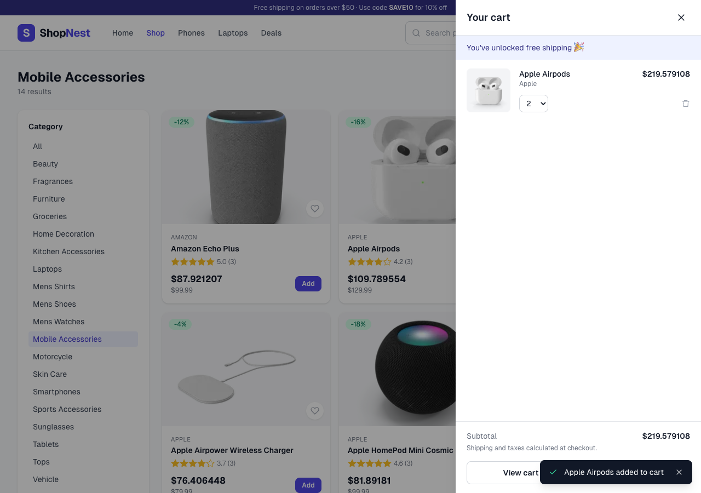

After

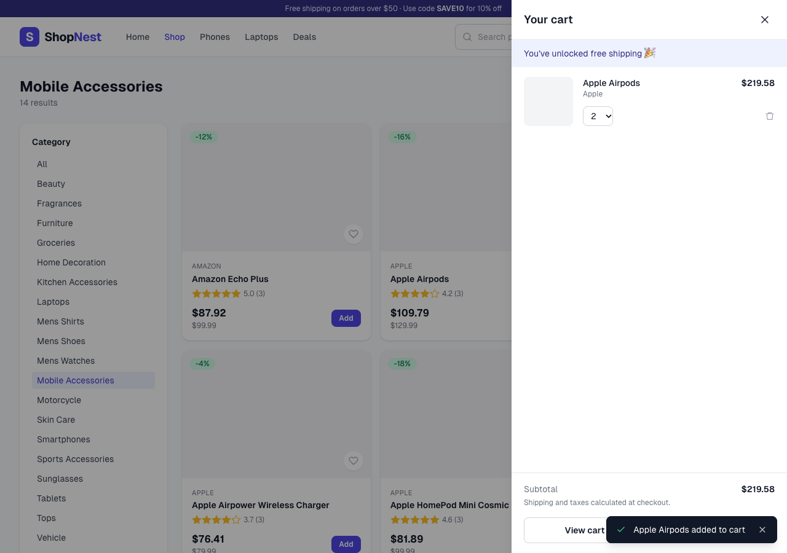

## Header badge immediately shows 2

Before

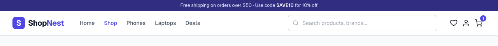

After

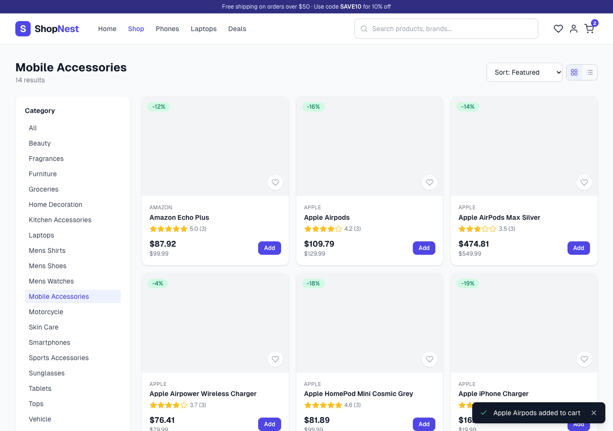

## Adding again gives quantity 3 and $329.37

Before

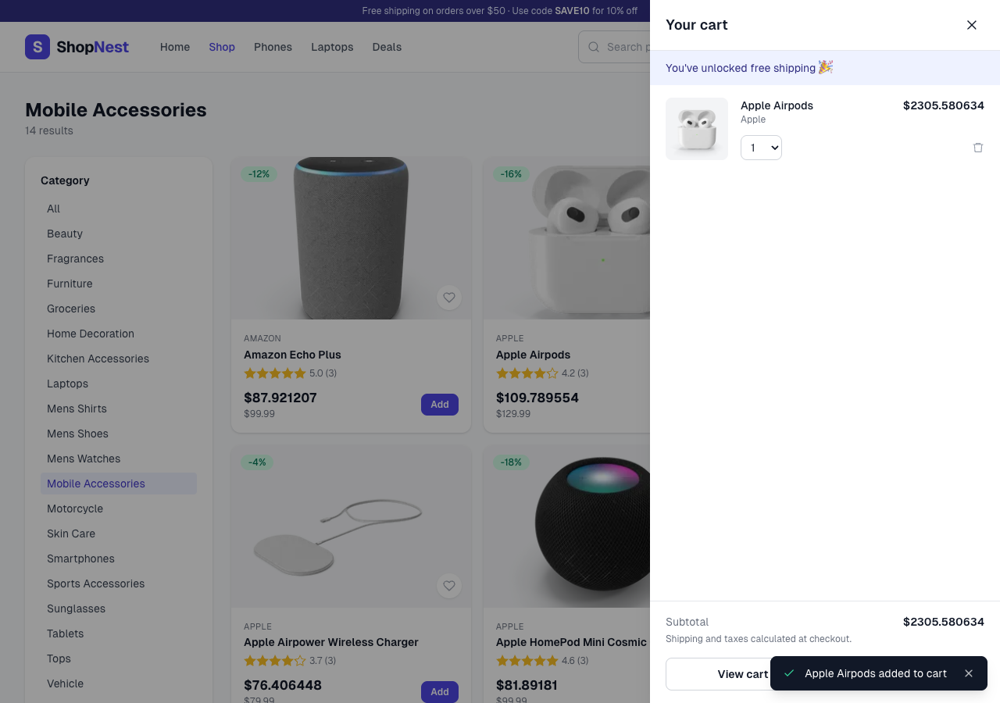

After

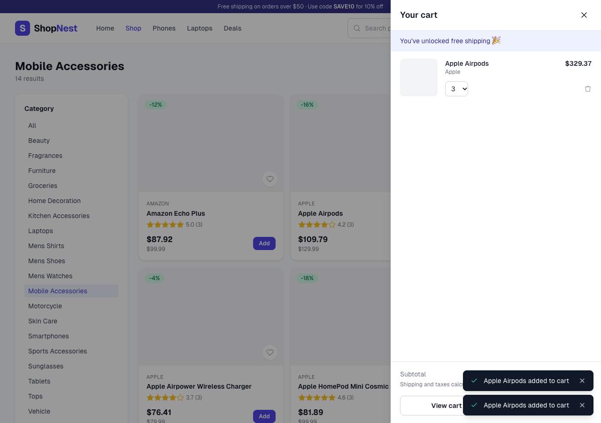

## Checkout summary uses quantity 3 and currency rounded to cents

Before

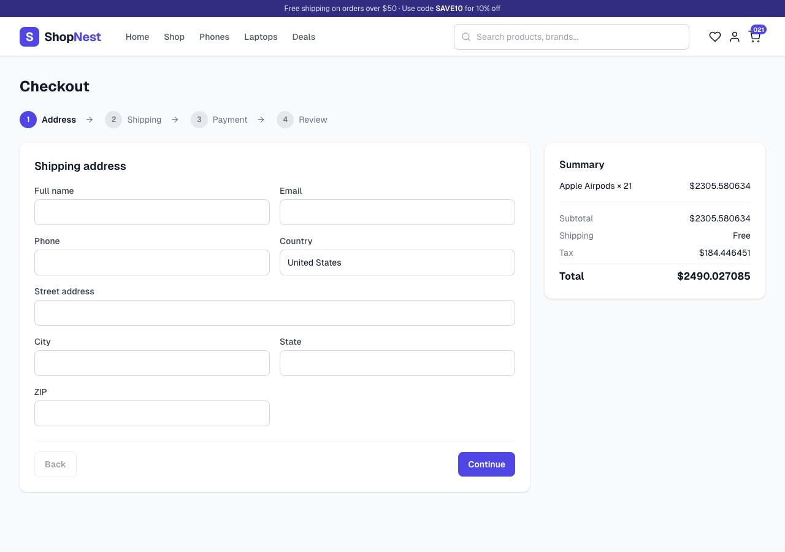

After

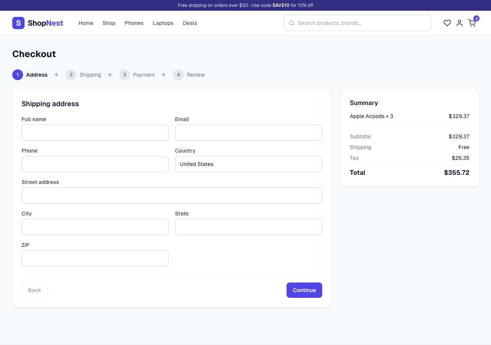

## Empty address stays on Address with field errors

Before

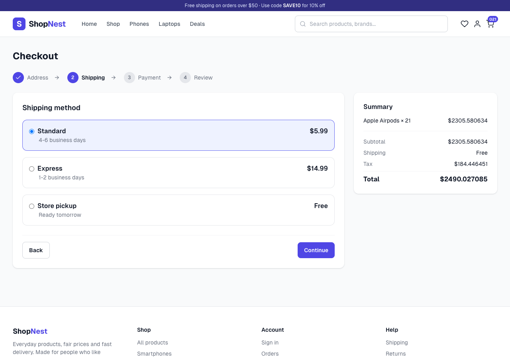

After

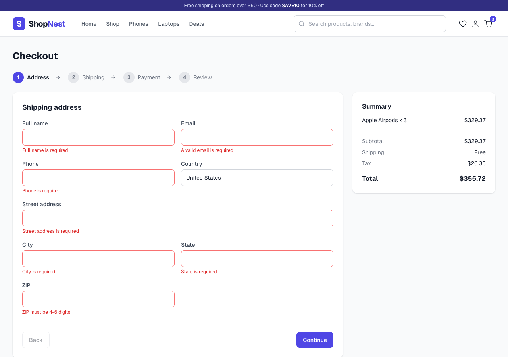

## Additional verification

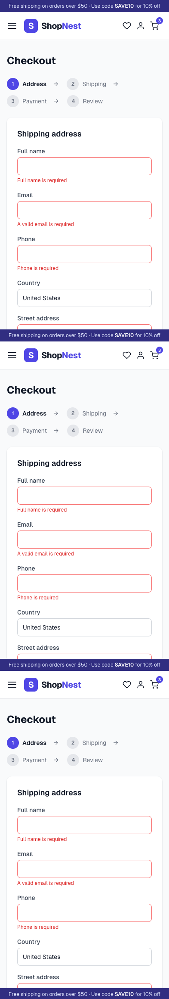

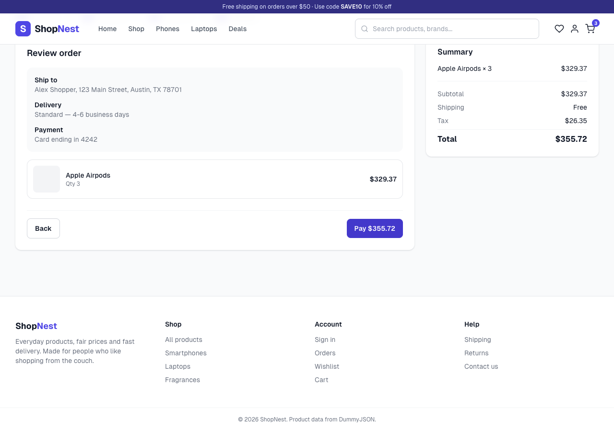

Browser assertions passed for quantity 2 → 3, immediate badge updates, $219.58/$329.37 subtotals, persistence after reload, seven empty-address errors, four empty-payment errors, valid progression to Review, $355.72 total, and no horizontal overflow at 393px. No order was submitted.

Production build and git diff --check passed. Existing image optimization lint warnings remain.
